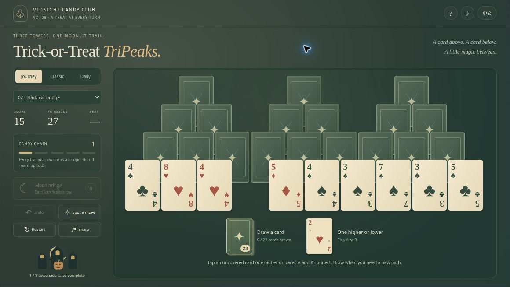
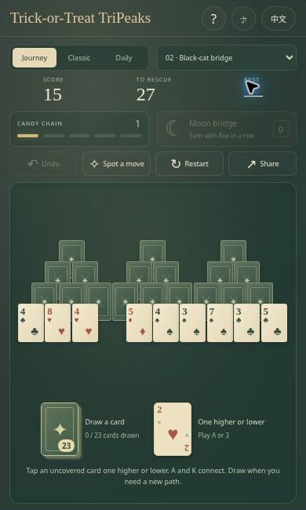

[English](README.md) | [简体中文](README.zh-CN.md) | [Español](README.es.md) | [Português (Brasil)](README.pt-BR.md) | [日本語](README.ja.md)

# 🎃 Trick-or-Treat TriPeaks — Paciência de Halloween com pontes lunares

**Três torres, uma trilha de doces e um atalho sob o luar.** Trick-or-Treat TriPeaks é uma paciência de Halloween criada para o [FreeCell Game](https://freecell-game.top/). Encadeie cartas de valor vizinho, limpe os picos e ganhe uma ponte lunar para continuar uma sequência difícil. Valetes de gato preto, damas bruxas e reis de abóbora dão personalidade às cartas originais.

**[Jogar agora](https://halloween-tripeaks.crazy3d.org/)** · [Coleção de Halloween](https://github.com/AshinTop/halloween-games) · [Guia de incorporação](EMBEDDING.md) · [Notas de design](DESIGN.md)

**Idiomas da documentação:** English, 简体中文, Español, Português (Brasil), 日本語. **Interface do jogo:** apenas inglês e chinês simplificado. Os demais idiomas do README não significam que os menus do jogo já foram traduzidos.



## O que vem no baralho? 👻

- **52 cartas completas:** 28 nos picos, 23 no monte e uma no descarte inicial.
- **Oito partidas Journey**, cada uma com solução verificada sem comprar cartas.
- Embaralhamentos Classic reproduzíveis e um desafio diário baseado em UTC.
- Pontes lunares limitadas, desfazer, dicas legais, estrelas, salvamento local e som sintetizado opcional.

## Como limpar os picos

Retire uma carta descoberta com valor um acima ou abaixo do descarte. Ela vira o novo descarte. Naipes e cores não importam. O Ás se conecta ao Rei, então **K–A–2** é válido. Uma carta continua coberta enquanto houver outra apoiada sobre ela. Remova todas as 28 cartas dos picos para vencer.

Você pode comprar quando quiser. Comprar reinicia a sequência. As 23 cartas do monte são usadas uma vez, sem redistribuição. A derrota só acontece quando o monte está vazio, nenhuma carta descoberta encaixa e não resta ponte lunar.

Cinco remoções normais seguidas podem render uma **ponte lunar**. Guarde uma por vez e ganhe no máximo duas por partida. Selecione a ponte e depois qualquer carta descoberta para ignorar seu valor. Cartas cobertas continuam bloqueadas. Usar a ponte reinicia a sequência; clicar novamente cancela a seleção. Desfazer restaura cartas, monte, pontos e magia.

Cada remoção normal vale 10 pontos mais a sequência atual × 5. Retirar o topo de um pico rende mais 50. A ponte vale os 10 pontos básicos e o eventual bônus do pico. Uma vitória sem compras recebe três estrelas; com até cinco compras, duas; as demais, uma. Não há cronômetro.

## Controles

| Ação | Entrada |
|---|---|
| Retirar carta | Clique / toque, ou Tab e Enter |
| Comprar | Monte; Espaço fora de botão ou campo |
| Usar magia | Ponte lunar, depois carta descoberta |
| Desfazer | Z ou botão |
| Mostrar jogada legal | Spot a Move |
| Repetir ou mudar modo | Reinício e seletor |

**Spot a Move mostra uma ação legal, não resolve a partida inteira.** Uma carta disponível agora não garante vitória depois.

## Escolha e compartilhe

[Journey 1](https://halloween-tripeaks.crazy3d.org/?level=1) inicia a campanha. [Classic com semente 12345](https://halloween-tripeaks.crazy3d.org/?mode=classic&seed=12345) compartilha um embaralhamento. Selecionar Classic novamente gera outro; reiniciar repete o atual. Um [desafio diário com data](https://halloween-tripeaks.crazy3d.org/?mode=daily&date=2026-10-31) mantém aquele dia UTC.

A partida atual, os melhores resultados e as preferências ficam salvos localmente. Parâmetros explícitos no link abrem a partida solicitada. O histórico de desfazer dura a sessão da página.

## Perguntas frequentes

**Toda partida tem solução?** As oito Journey têm soluções testadas. As misturas Classic e Daily não têm essa garantia.

**A ponte remove uma carta coberta?** Não. Ela ignora o valor, mas mantém a regra de cobertura.

**Posso reutilizar o monte?** Não. Escolher quando comprar, prolongar sequências e guardar pontes faz parte da estratégia.

## Imagens e vídeo



Interface real capturada em um iframe compacto no navegador. A imagem mostra a organização dos controles; não representa um teste de desempenho em um celular físico.

[Assista à apresentação de 24 segundos](https://halloween-tripeaks.crazy3d.org/intro.html) · [Baixe o MP4 com legendas](docs/media/intro.mp4). O vídeo é silencioso e foi montado com capturas reais do jogo, não com uma partida gravada continuamente. As imagens registram a interface na data da captura e podem ser anteriores a melhorias visuais posteriores.

## Coloque o jogo no seu site

```html
<iframe src="https://halloween-tripeaks.crazy3d.org/"
  title="Trick-or-Treat TriPeaks"
  style="display:block;width:100%;height:654px;border:0"
  allow="fullscreen" allowfullscreen></iframe>
```

As cartas se ajustam ao espaço disponível no desktop, em retrato estreito e em paisagem baixa. Defina uma altura real para o iframe e preserve a leitura dos cantos. O jogo não acessa o documento pai nem precisa de câmera, microfone ou bloqueio do ponteiro.

A versão on-line é publicada no Cloudflare a partir deste repositório do GitHub. Defina uma altura real para o iframe e reserve espaço para a barra do site principal. O site pode oferecer tela cheia. Consulte [EMBEDDING.md](EMBEDDING.md) para os detalhes.

## Executar e verificar localmente

```sh
python3 -m http.server 4173
```

Sirva a pasta raiz do repositório e abra [http://localhost:4173/](http://localhost:4173/). O jogo é estático, sem compilação ou instalação de dependências. Use HTTP(S), pois abrir por `file://` pode bloquear os módulos JavaScript. Os testes exigem Node.js.

```sh
npm test
```

Os **12 testes** cobrem as oito soluções Journey, baralho sem duplicatas, cobertura, ligação Ás/Rei, uso do monte, obtenção e limites de pontes, derrota, embaralhamento reproduzível, datas e validação dos dados salvos.

O código do jogo não exige conta, API remota, SDK de anúncios nem CDN de arquivos externos. Os registros ficam no navegador, sem sincronização na nuvem. O Cloudflare pode adicionar scripts de hospedagem e registros de requisições. O áudio sintetizado opcional segue as permissões do navegador.

## Outras aventuras ao luar 🍬

- [Haunted FreeCell](https://halloween-freecell.crazy3d.org/) · [Código](https://github.com/AshinTop/halloween-freecell) — FreeCell clássico e finais Lantern Rescue.
- [Pumpkin Shift](https://halloween-pumpkin-shift.crazy3d.org/) · [Código](https://github.com/AshinTop/halloween-pumpkin-shift) — Quebra-cabeças deslizantes com Moon Glides.
- [Witch’s Candy Blocks](https://halloween-block-blast.crazy3d.org/) · [Código](https://github.com/AshinTop/halloween-block-blast) — Encaixe blocos de doces em um tabuleiro 8×8.
- [Pumpkin 2048](https://halloween-2048.crazy3d.org/) · [Código](https://github.com/AshinTop/halloween-2048) — Fusões clássicas e Lantern Trials.

## Créditos e apoio

Criado para o **Midnight Candy Club de AshinTop**, com colaboração de IA orientada por pessoas em design, programação, documentação, testes e revisão. As ilustrações originais e os sons sintetizados foram feitos para este projeto. Veja as [notas de design](DESIGN.md).

Gostou desta pequena aventura? **[Deixe uma estrela para Trick-or-Treat TriPeaks no GitHub](https://github.com/AshinTop/halloween-tripeaks)** para guardar o projeto e acompanhar novidades. Ao relatar um problema, informe fase ou modo, navegador, tamanho da janela e passos para reproduzi-lo. Conheça a [coleção completa de Halloween](https://github.com/AshinTop/halloween-games).
